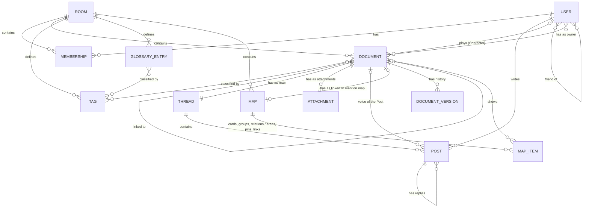

# Ex Libris (collaborative TTRPG notes platform) — Requirements analysis

| | |
|---|---|
| **Version** | 0.6 |
| **Date** | 27 October 2026 |
| **Status** | Aligned with what is built on `staging` (specs 01–45); implementation status per requirement in section 14 |
| **Audience** | Project team and the Agents that will use this document as their base Context |

**New in 0.2:** resolved Open points OQ-01…OQ-08 (now Decisions D-11…D-18); introduced the Administrator role; a Document's "fields" are now Details in the main Thread; the Glossary can be filtered by Tag; new Open points OQ-09…OQ-12.

**New in 0.3:** resolved Open points OQ-11 and OQ-12 (now Decisions D-19, D-20), ahead of the Documents/Details unit. OQ-09 and OQ-10 stay formally open but are already implemented in practice by the Rooms/Membership unit (see `progress-tracker.md`).

**New in 0.4:** new Decisions D-21…D-27: **PDF Attachments** on Documents, **Characters** linked to a User with Posts written "as the Character", **Friendships** between Users (the first concept not tied to a Room). New rules VR-12, VR-13, requirements FR-D8, FR-D9, FR-T11, FR-F1…FR-F5, use cases UC-20…UC-25, invariants I-12…I-14. Tickets: `context/feature/15`…`18`. The document was also translated from Italian to English; IDs and meaning are unchanged.

**New in 0.6** (27 October 2026, product owner's request to align the spec with the app): the product is named **Ex Libris**. Maps, which 0.5 left out of scope, are now in: **free relationship maps**, **live mention maps** and **geographic maps**, with **Relational link Notes**, maps that **Players can edit** and maps refreshed while open (D-30…D-36; D-04 amended). New Decisions also for the Document subtitle, Room image, Room duplication, Document export/import and PDF, personal data (GDPR), twelve UI languages, the landing page with a read-only Demo, and the dropping of FR-G2 (D-37…D-45). New requirements FR-A3…A4, FR-R9…R10, FR-D10…D15, FR-M1…M9, FR-G3…G4, FR-L1…L2; NFR-09 widened, NFR-10 added; VR-07 widened, VR-14…VR-16; UC-26…UC-33; W-07. Section 14 now records what is built, partial, not built or dropped for every requirement. Glossary entries (FR-N3/N4, VR-10) are **not built**: the Room Index (spec 44) is the navigation that exists.

**New in 0.5:** resolved Open points OQ-09 and OQ-10 (now Decisions D-28, D-29). **Details** are aligned with what was built (Notes): managed by the Document's Owners and the Master, outside the Thread, no replies (D-18, D-19, I-08, I-10, FR-D3, FR-T1, FR-T8, FR-T10). Login lists the providers of FR-A1: Google, Discord and GitHub; Facebook and X were dropped (D-07, UC-01, NFR-03, MoSCoW). Images are plural with a cap (D-09, FR-D1). New NFR-09 (UI languages). Removing a Friendship revokes pending direct invitations (D-26); members' emails are not shown to other members (NFR-03).

---

## 1. Purpose of this document

This document is the project's base guideline. It is used to:

1. fix requirements, use cases, features and workflows before implementation;
2. give the Agents that will work on later implementations a **stable, unambiguous Context**.

**Reading conventions**

- Every item has a **stable ID** (`D-` decisions, `OQ-` open points, `VR-` visibility rules, `FR-` functional requirements, `NFR-` non-functional, `UC-` use cases, `W-` workflows, `I-` invariants). Always refer to the IDs, not to paraphrases.
- Capitalized terms are defined in the Glossary (section 3) and must be used with that meaning.
- Anything not in the Decisions (section 5) is a **proposal**, not a confirmed choice.

---

## 2. Vision and scope

A web application, distributed online, where several Users contribute to the documentation and notes of a campaign of any TTRPG (game-system agnostic).

**Goals**

- Gather a campaign's information in one place (places, NPCs, events, artifacts and more).
- Allow contextual conversations about the content through Threads.
- Control precisely who sees what (the Master's secrets, individual Players' information).
- Produce a structured knowledge base, usable by Agents too.

**Out of scope for now**

- Real-time collaborative editing of text (D-04). *(Maps are the exception: an open map is refreshed every few seconds and saves only what changed, D-36.)*
- Managing rules, character sheets, dice, battle maps or combat. *(A character sheet can however be **attached** as a PDF file to the Character's Document, D-21: the platform stores it, it doesn't interpret it. Relationship and geographic maps are in scope since 0.6, D-30, D-32: they are notes about the campaign, not a tactical battle grid.)*
- A native mobile app (the web interface must still be usable from a smartphone).
- Translating user content (Documents, Notes, Comments, Tag names): only the interface is translated (NFR-09).

---

## 3. Glossary

| Term | Definition |
|---|---|
| **User** | A person authenticated on the platform (Google, Discord or GitHub login). |
| **Room** | The container of a campaign: it has members, Documents, Tags, a Glossary. |
| **Membership** | The link between a User and a Room, with their roles in that Room. |
| **Master** | A User's role in a specific Room, with full Ownership of the content. |
| **Player** | A User's role in a specific Room, with their own contributions and visibility. |
| **Administrator** | The Room management role (members, roles, invitations). Given to the creator by default; several Users can hold it (D-11). |
| **Document** | A unit of knowledge in a Room (place, NPC, event, artifact, etc.). It has no rigid type (D-05). |
| **Tag** | A label to classify and navigate Documents and Glossary entries. "Types" are Tags (D-05). |
| **Glossary** (or Dictionary) | The Room's set of entries (term + definition), filterable by Tag (D-14). *Not built (section 14): the app's navigation is the Room Index.* |
| **Room Index** | The small card opened from a tab on the left edge of every Room page, with links to the Room's sections: the Main Tags' groups of Documents and the Maps (spec 44). |
| **Thread** | A conversation tied to a Document, made of nested Posts. Every Document has a main Thread. |
| **Post** | A single contribution in a Thread (a **Comment** or a reply). |
| **Detail** | An additional titled Description attached to a Document, called a **Note** in the app (e.g. "Distinguishing marks: has a wooden leg that creaks with every step") (D-18). |
| **Ownership (of a Document)** | The right to edit the Document and manage its visibility. Reassignable (D-12). |
| **Visibility** | The set of Users who can see a piece of content. |
| **Reveal** | An action that widens a piece of content's visibility, with tracking. |
| **Agent** | An automated consumer of context that acts with the permissions of the User it acts for. |
| **Attachment** | A PDF file uploaded to a Document (e.g. a Character's sheet). It has the Document's visibility (D-21). |
| **Character** | A Document played by a member of the Room (its **Character player**), usually a PC. It is a Document like any other, plus the link to its player (D-23). |
| **Character player** | The member of the Room linked to a Character. They can write Posts as that Character (D-24). Not to be confused with the Player role. |
| **Friend** | A User linked to another User by an accepted Friendship, independently of Rooms (D-26). |
| **Subtitle** | An optional one-line text under a Document's name ("La Idol"), part of the Document (D-37). |
| **Map** | A board of the Room, with its own visibility. Three kinds: a **free map** (relationship map) of cards, groups and labeled relations drawn by hand (D-30); a **mention map**, drawn live from a Document's mentions (D-31); a **geographic map**, a plane with a background image, areas, pins and links (D-32). |
| **Relation** | A line or arrow between two cards (or groups) of a free map, with an optional label for each direction. It belongs to its map only (D-30). |
| **Relational link** | A Note flagged so that the mentions written in it feed mention maps (D-33). |
| **Demo** | A read-only tour of the real app over a sample Room kept in the visitor's browser, with no account and nothing saved (D-44). |
| **Friend code** | A personal, regenerable code or link through which a User can receive Friendship requests (D-27). |

---

## 4. Actors and roles

| Actor | Description |
|---|---|
| Visitor | Not authenticated. Sees the landing page, the privacy notice and the read-only Demo (D-44), and can sign in. |
| User | Authenticated. Can create Rooms and receive invitations. |
| Administrator | Per-Room role. Manages members, roles and invitations. Given to the creator by default; several Administrators are possible (D-11). |
| Master | Per-Room role. Full Ownership of the content, sees every piece of content in the Room. |
| Player | Per-Room role. Contributes and manages the visibility of their own content. |
| Agent (future) | Acts with a User's scope. Today it consumes the export a User downloads (FR-G1); direct API access (FR-G2) was dropped (D-45). |

**Roles depend on the Room** (D-06): the same User can be Master in one Room and Player in another.

*Decision (D-28):* the Administrator role **can be combined** with Master or Player: a User always has at least one narrative role (Master or Player) and can additionally be Administrator. A Room's creator starts as Administrator and Master.

---

## 5. Decisions made

| ID | Decision |
|---|---|
| D-01 | The **Master also sees Players' private content**. Comments that are 100% private (Master included, "sealed content") are a possible evolution but not a priority. |
| D-02 | A Room can have **several Masters (co-GMs)**, not a priority. A general Room management system is needed: Administrator Users, editable roles, Users who join or are invited. |
| D-03 | A **Document's description** is edited by **anyone with Ownership** of that Document. |
| D-04 | **No real-time editing** for now. Priority to an **efficient Thread structure**. *(Amended in 0.6: maps are saved change by change and refreshed while open, D-36; text stays without live co-editing.)* |
| D-05 | Documents are **not strictly typed**: "Types" (NPC, Place, Event, Artifact…) are treated as **Tags**. |
| D-06 | Roles (Master/Player/Administrator) are **per Room**, not global. |
| D-07 | Login through **Google** (preferred method), plus Discord and GitHub (FR-A1). |
| D-08 | Every **Player owns the visibility of their own content** with respect to the other Players. The **Master has full Ownership** of the project (Room). |
| D-09 | Every Document can have a Name, **up to 20 Images** (one of them the favorite), a description, Tags and further details (defined in D-18). |
| D-10 | Content, single comments and other information can be **hidden from different Users**. |
| D-11 | The **Administrator is a third role**, given by default to the Room's creator. **Several Users can be Administrators at the same time.** *(resolves OQ-01)* |
| D-12 | **Document Ownership:** the creator is Owner by default; the Master and Owners can add or remove Owners (Ownership can be reassigned to others). The **Master always has implicit Ownership**. *(resolves OQ-02)* |
| D-13 | **Players can create Documents** by default; the option can be turned off per Room by the Master. *(resolves OQ-03)* |
| D-14 | **Tags with an optional category** (e.g. "Type", "Faction"); default Tags (NPC, Place, Event, Artifact) are created with the Room and editable. The **Glossary/Dictionary can be filtered by one or more Tags**. *(resolves OQ-04)* |
| D-15 | **The content of a User who leaves or is removed stays visible, unless deleted**. Ownership of their Documents can be reassigned; the Master has implicit Ownership anyway. *(resolves OQ-05)* |
| D-16 | The **Administrator can designate a new Master**. **The last Administrator cannot leave** the Room without designating a new Administrator. *(resolves OQ-06)* |
| D-17 | A **reply to a Post cannot be more visible than its parent Post**. *(resolves OQ-07)* |
| D-18 | A **Document's details** are **further Descriptions (Details, called Notes in the app)** attached to the Document, each with a title and content, shown under the description. There are no structured custom fields. *(resolves OQ-08; amended in 0.5: Details are not Posts of the Thread)* |
| D-19 | A **Detail** is added, edited, deleted and reordered by the **Document's Owners and the Master** only. It has **its own visibility** (section 8; "Private" = the Document's Owners + the Master) and **no replies**: discussion happens in the Thread's Comments. Limits: 200-character title, 50 Details per Document. Details come with the single Document, not with the Document list or card. *(resolves OQ-11; amended in 0.5 to the model built in spec 12)* |
| D-20 | **One main Thread per Document**: no additional Threads in v1. *(resolves OQ-12)* |
| D-21 | A Document can have **PDF Attachments**. An Attachment **has no visibility of its own**: whoever sees the Document sees it. A secret file goes on a secret Document. |
| D-22 | Attachments are **uploaded and removed by the Document's Owners and the Master** (D-12). Limits: **10 MB per file, 10 Attachments per Document**. The file is validated by its content (not its name) and is always opened or downloaded as a separate file, never embedded in the application's page. |
| D-23 | A Document can be a **Character** linked to **a single** member of the Room (its Character player); a member can have **several Characters**. The link is neither a custom field (I-08) nor a type (D-05): it is a relation, like Ownership. It is set by **the Master or an Owner of the Document**; the Character player doesn't have to confirm. Linking the Character player can also make them an Owner (the proposed default). If the Character player leaves or is removed, the link is dropped and the Document stays (D-15). |
| D-24 | A member can write a Post **as one of their own Characters**. The **Master can write as any Document** of the Room (to give NPCs a voice). The Post still belongs to the User who writes it: edit, delete and visibility permissions don't change. |
| D-25 | A Post written as a Character shows the Character's name and image **only to those who see the Character's Document**; everyone else sees the real author, as with a normal Post (VR-13). |
| D-26 | Users can form **Friendships**, valid across Rooms: request, acceptance or refusal, removal by either side. In v1 a Friendship is used to **invite a Friend directly into a Room**: the invitation stays pending until the Friend accepts it, nobody joins a Room without consenting. **Removing a Friendship revokes the pending direct invitations** between the two. Profile privacy tied to Friendships is a later evolution. |
| D-27 | A Friendship request can be sent **only to a member of a shared Room** or through their **Friend code**. There is no search by name or email (it would reveal who has an account). Declining or removing is silent; a declined request cannot be repeated for 30 days. No blocking in v1. |
| D-28 | The **Administrator role can be combined** with Master or Player. **Administrator** = Room management (members, roles, invitations, archiving/deletion, Room setup and Main Tags, designating Masters and Administrators). **Master** = powers over content (D-08). An Administrator who isn't a Master has no extra visibility over content. The creator starts as Administrator + Master. *(resolves OQ-09)* |
| D-29 | A Room is never **without a Master**: the last Master cannot leave or be demoted without a replacement; the Administrator can designate one (D-16). *(resolves OQ-10)* |
| D-30 | **Free maps** (relationship maps) are boards where Documents are placed as cards, with text cards, groups and labeled **relations**. A relation **belongs to its map only**: there are no Room-wide relationships and nothing is shown on the Document's page because of it. Any member who may create Documents (D-13) creates a map; its creator and the Master manage it. A map has a visibility of its own, with the Comment levels and its creator as Owner. Limits: 100 maps per Room, 150 cards per map. *(spec 28)* |
| D-31 | A Document can have a **mention map**: a board centered on it with the Documents it mentions and that mention it, up to 3 steps out. It is **live**: computed from the visible mentions on every read, so writing or removing a mention changes it. It is shown on the Document's page under its images, and can be copied into a free map. *(spec 36)* |
| D-32 | **Geographic maps** are a plane with an optional background image, **areas** (shapes), **pins** (points, optionally bound to a Document) and labeled **links** between pins. They can be imported from and exported to a JSON file, and linked to a Document. A click on a Document's pin opens the Document beside the map. *(specs 38, 38b)* |
| D-33 | A Note can be flagged as a **Relational link**. **Only the mentions written in flagged Notes draw relations on mention maps**; descriptions, unflagged Notes and Comments still count as mentions everywhere else (backlinks, search). *(spec 41)* |
| D-34 | Saving a description or a Note **links the names of the Room's Documents automatically** as mentions, and a "Generate mentions" action does it on existing text. Only Documents the writer sees are linked. *(spec 39)* |
| D-35 | A free or geographic map can be **unlocked for Players** (off by default): every member who sees it then edits its board; settings, visibility, deletion, plane, background and linking stay with its creator and the Master. *(spec 42)* |
| D-36 | A map is saved **change by change** (each moved, added or removed item), laid over the stored board, so several editors never overwrite each other, and an open map is **read again every 5 seconds**. No push, no presence, no editing of maps from a phone. *(spec 43)* |
| D-37 | A Document has an optional **subtitle** (≤120 characters, one line), edited by whoever edits its name and shown under it; a map card shows it as its default caption. *(spec 28_0)* |
| D-38 | A Room has an optional **image**, set by an Administrator; it is the default cover of the Room PDF. *(spec 26)* |
| D-39 | The **Master** can **duplicate** a Room: the copy holds its setup, Tags, Documents (with Notes and images) and maps, but no Comments, PDF Attachments, history or members except the person duplicating, who becomes Master and Administrator. Selective visibility becomes Private in the copy. *(specs 33, 40)* |
| D-40 | Export and import: a Room or a single Document is exported as JSON or Markdown (FR-G1) and as a **PDF laid out like a game manual**, in a chosen style (Gothic, Modern, Print, Parchment); always only what the requester sees. *(The PDF of a single Document, spec 27b, is specified but not built yet.)* One or more Documents, or a whole Room export, can be **imported** by whoever may create Documents, copying or replacing content only: no Comments, Owners, grants or Attachments. *(specs 23, 23b, 27, 27b, 35)* |
| D-41 | **Personal data (GDPR)**: a User can download all their personal data and **delete their account** permanently, at once, without a grace period. Their profile, sign-in account, Friendships, reactions and grants are erased; **content written in shared Rooms stays**, shown as by "Unknown user". A public privacy notice is reachable without signing in. *(spec 31)* |
| D-42 | The interface is offered in **twelve languages**: English, Italian, German, Spanish, French, Dutch, Polish, European Portuguese, Russian, Japanese, Korean and Simplified Chinese; the ten added after English and Italian are marked beta until a native speaker reviews them. The API's error messages follow the same choice. *(specs 09, 09_1, 34)* |
| D-43 | Reading aids that stay in the browser: **read aloud** of a Document with the browser's own voices, and **image search** over free image libraries (Openverse) to add an image to a Document. Neither adds stored personal data. *(specs 29, 30, 30b)* |
| D-44 | The site opens on a public **landing page** for everyone; the Rooms list is a page of its own. A **read-only Demo** shows the real pages over a sample Room kept in the browser (English or Italian), with a Master/Player switch and a guided tour; nothing reaches the server. *(spec 45)* |
| D-45 | **FR-G2 (API access with a personal token for Agents) is dropped** (product owner, 2026-10-06; ticket 23c). The export of FR-G1 is the Agent-facing surface. |

---

## 6. Open points

| ID | Question | Working proposal |
|---|---|---|
| — | No open points at the moment. | — |

**History of resolved Open points:** OQ-01 → D-11 · OQ-02 → D-12 · OQ-03 → D-13 · OQ-04 → D-14 · OQ-05 → D-15 · OQ-06 → D-16 · OQ-07 → D-17 · OQ-08 → D-18 · OQ-09 → D-28 · OQ-10 → D-29 · OQ-11 → D-19 · OQ-12 → D-20.

---

## 7. Domain model

**Notes on the model**

- `MEMBERSHIP` holds the User's **roles** in the Room: Master or Player, plus the optional Administrator (D-06, D-11). It is what makes the role depend on the Room.
- `DOCUMENT` **has no "type" field**: classification happens through `TAG` (D-05).
- `DOCUMENT` **has no custom fields**: additional information is **Details** (`NOTE`s) attached to the Document (D-18).
- Every visible piece of content (Document, information block, Post, Glossary entry) has an associated **Visibility rule**.
- `DOCUMENT` ↔ `USER` (owner) represents **Ownership** (D-03, D-12).

**Main entities and indicative attributes**

- **User:** id, sign-in identity (name, avatar, email).
- **Room:** id, name, description, game system (free text), status (active/archived), image (D-38), default visibility (VR-05), Players-can-create-Documents flag (D-13).
- **Membership:** user, room, narrative role (Master/Player), Administrator flag, join date.
- **Document:** id, name, subtitle (D-37), images, description, Tags, Owners, visibility, version history (one history per Document covering name, description and Notes); main Thread.
- **Tag:** name, optional category, Room; the Room's **Main Tags** (ordered by an Administrator) group the Documents list and the Room Index.
- **GlossaryEntry:** term, definition, Tags, visibility, Room. *(Not built, section 14.)*
- **Thread:** owning Document; contains the Posts.
- **Post:** author, content, parent Post, visibility, status, timestamps.
- **Detail (Note):** Document, title, content, position, visibility, Relational link flag (D-18, D-19, D-33).
- **Invitation:** Room, code/link, proposed role, expiry, status.
- **AuditLog:** who, what, when (visibility, role and Ownership changes, Reveal, a Character's player).
- **Attachment:** Document, display name, size, type (PDF), who uploaded it, date (D-21, D-22).
- **Document (Character):** optional Character player, a member of the Room (D-23).
- **Post (as a Character):** optional Document that "speaks" in the Post (D-24).
- **Friendship:** pair of Users, who asked, status (pending / accepted / declined), creation date, answer date (D-26). A declined Friendship is kept with its decline date so a new request can be refused for 30 days (D-27). Belongs to no Room.
- **FriendCode:** User, code, creation date (D-27).
- **Map:** Room, kind (free, mention, geographic), name, description, visibility, creator, Players-can-edit flag (D-35), revision; for a mention map its center Document and depth; for a geographic map its plane size and background image (D-30…D-32).
- **Map items:** on a free map, cards (a Document or a text), groups and relations; on a geographic map, areas, pins (optionally a Document) and links. Each item can be Master only.
- **Reveal:** content, who revealed it, from and to which level, the members who gained it and whether they have seen it (VR-06).
- **Export / import job:** requester, Room, format and options, status, expiry (24 hours for a PDF, 7 days for an import).

---

## 8. Visibility model

**Levels**

| Level | Who sees it |
|---|---|
| Room | Every member of the Room |
| Master only | Only the Masters |
| Private | The author/Owner and the Master |
| Selective | Author/Owner, Master and a list of chosen Users |

**Rules**

| ID | Rule |
|---|---|
| VR-01 | The **Master sees every piece of content** in the Room, whatever its level (D-01). |
| VR-02 | A **Player decides the visibility of their own content** with respect to the other Players (D-08). |
| VR-03 | Visibility applies to **Documents, Document blocks, Posts (Comments) and Details** (D-10). |
| VR-04 | A **reply cannot be more visible than its parent Post** (D-17). |
| VR-05 | Every Room defines a **default visibility** for new content. |
| VR-06 | **Reveal** widens visibility and is recorded (who, when, from/to which level). |
| VR-07 | The visibility filter is applied **server-side** at every exit point: lists, search, Tag filters, Glossary, counts (Tag counts too), backlinks, mention maps, map cards and pins, the Room Index, images, version history, exports (JSON, Markdown, PDF), the "View as" preview, API and Agent context. |
| VR-08 | Every visibility change is tracked in the AuditLog. |
| VR-09 | *(evolution, not a priority)* **Sealed** content: private from the Master too (D-01). |
| VR-10 | *(proposal)* **Glossary entries** are content with a visibility, so they don't reveal hidden information. |
| VR-11 | The content of a User who leaves stays subject to the visibility that was set (D-15). |
| VR-12 | An **Attachment** has its Document's visibility; there is no visible Attachment on a hidden Document (D-21). |
| VR-13 | A Post written **as a Character** doesn't reveal the Character to those who don't see its Document: for that reader the Post shows the real author (D-25). |
| VR-14 | A **map** has its own visibility (the Comment levels, its creator as Owner). A card or pin bound to a Document is drawn only for those who see that Document, and a relation or link only when both its ends are drawn; a Master-only item is drawn only for Masters (D-30, D-32). |
| VR-15 | A **mention map** is seen by whoever sees its center Document, and shows only Documents the viewer sees, tied by mentions written in Relational link Notes the viewer sees (D-31, D-33). |
| VR-16 | An editor of a map never sees, moves or removes the items hidden from them: their saves leave hidden items as they are (D-30, D-35). |

---

## 9. Ownership and permissions

**Ownership of a Document (D-12):** the creator is Owner by default. The Master and Owners can add or remove Owners. The Master is always an implicit Owner. Whoever isn't an Owner contributes through the Thread (Comments).

**How to read the matrix:** the Administrator column shows only the **Room management powers**. Powers over content come from the narrative role (Master/Player) and from Ownership (D-28).

| Action | Administrator | Master | Document Owner | Other members | Non-member |
|---|---|---|---|---|---|
| Edit/archive/delete the Room | ✅ | ❌ | — | ❌ | ❌ |
| Invite, remove members, change roles, designate Masters and Administrators | ✅ | ❌ | — | ❌ | ❌ |
| Create Documents | — | ✅ | — | ✅ (D-13) | ❌ |
| Edit a Document's description | — | ✅ | ✅ | ❌ | ❌ |
| Reassign Ownership | — | ✅ | ✅ | ❌ | ❌ |
| Manage Tags and Glossary | ✅ | ✅ | ❌ | ❌ | ❌ |
| Room setup and Main Tags (D-28) | ✅ | ❌ | — | ❌ | ❌ |
| Post Comments (where visible) | — | ✅ | ✅ | ✅ | ❌ |
| Add, edit, reorder Details (D-19) | — | ✅ | ✅ | ❌ | ❌ |
| Set the visibility of one's own content | — | ✅ | ✅ | ✅ | ❌ |
| See others' non-public content | ❌ | ✅ | Only if allowed | Only if allowed | ❌ |
| Moderate or delete others' Posts | — | ✅ | ❌ | ❌ | ❌ |
| Reveal others' content | — | ✅ | ❌ | ❌ | ❌ |
| Upload or remove PDF Attachments (D-22) | — | ✅ | ✅ | ❌ | ❌ |
| Link a Character to its Character player (D-23) | — | ✅ | ✅ | ❌ | ❌ |
| Write as a Character (D-24) | — | ✅ (any Document) | Only if Character player | Only if Character player | ❌ |
| Invite a Friend directly into the Room (D-26) | ✅ | ❌ | — | ❌ | ❌ |
| Set the Room image (D-38) | ✅ | ❌ | — | ❌ | ❌ |
| Duplicate the Room (D-39) | ❌ | ✅ | — | ❌ | ❌ |
| Export the Room or a Document (only what one sees) | — | ✅ | ✅ | ✅ | ❌ |
| Import Documents (D-40) | — | ✅ | — | ✅ (D-13) | ❌ |
| Create a map (D-30) | — | ✅ | — | ✅ (D-13) | ❌ |
| Manage a map: settings, visibility, deletion (D-30) | — | ✅ | Map creator | Map creator | ❌ |
| Edit a map's board (D-35) | — | ✅ | Map creator, or anyone who sees it when unlocked | Map creator, or anyone who sees it when unlocked | ❌ |

*The Administrator/Master split is confirmed by D-28; the Details rows by D-19; the map rows by D-30 and D-35.*

---

## 10. Functional requirements

### Authentication
- **FR-A1** Login with Google (OAuth), Discord and GitHub.
- **FR-A2** Basic profile (name, avatar) and logout.
- **FR-A3** Download all of one's personal data as a file (D-41).
- **FR-A4** Delete one's own account permanently; shared content stays, anonymised (D-41). A public privacy notice is reachable without signing in.

### Rooms and members
- **FR-R1** Create, edit, archive and delete a Room. Whoever creates the Room becomes Administrator (D-11) and Master (D-28).
- **FR-R2** Invite through a link or code, with expiry and revocation.
- **FR-R3** Accept an invitation and join with the proposed role.
- **FR-R4** Manage members: change roles, give the Administrator role to several Users, remove, leave (D-02, D-11).
- **FR-R5** Designate a new Master (D-16). Several Masters at once (co-GM) are possible but not a priority (D-02).
- **FR-R6** List of one's own Rooms with the roles in each.
- **FR-R7** The last Administrator cannot leave without designating a new Administrator (D-16).
- **FR-R8** When a User is removed or leaves, their content stays visible unless deleted, and the Ownership of their Documents can be reassigned (D-15).
- **FR-R9** Room image, set by an Administrator, shown on the Room card and as the default PDF cover (D-38).
- **FR-R10** Duplicate a Room, by its Master (D-39).

### Documents
- **FR-D1** Document CRUD with name, images (up to 20, D-09), description (rich text or Markdown), Tags.
- **FR-D2** Management and reassignment of the Document's Ownership (D-12).
- **FR-D3** Add **Details** (further titled Descriptions) to the Document, shown under its description (D-18, D-19).
- **FR-D4** Links between Documents through mentions, with backlinks.
- **FR-D5** Change history with restore.
- **FR-D6** Draft/published status.
- **FR-D7** Per-Room option that enables/disables Document creation by Players (D-13).
- **FR-D8** **PDF Attachments** on a Document: upload, list, open, download, remove (D-21, D-22). Deleting a Document or a Room also deletes its Attachments.
- **FR-D9** Link a Document to a member as a **Character**, change or remove the Character player (D-23), tracked in the AuditLog.
- **FR-D10** Optional **subtitle** of a Document (D-37).
- **FR-D11** Automatic linking of Document names as mentions on save, and a "Generate mentions" action on existing text (D-34).
- **FR-D12** Flag a Note as a **Relational link** (D-33).
- **FR-D13** Find an image in free image libraries and add it to a Document (D-43).
- **FR-D14** Read a Document aloud with the browser's voices (D-43).
- **FR-D15** Preview a mentioned Document on hover, and open a Document or a map side by side with another (split view).

### Tags, Glossary and navigation
- **FR-N1** Per-Room Tags, with an optional category and default Tags on creation (D-14).
- **FR-N2** Filter Documents by one or more (combinable) Tags and navigate by category.
- **FR-N3** Glossary with entries, definitions, Tags and links to related Documents.
- **FR-N4** **Filter the Glossary/Dictionary by one or more Tags** (D-14).
- **FR-N5** Full-text search over Documents, Posts and Glossary, always filtered by visibility.
- **FR-N6** Recognize Glossary terms in text (Could).
- **FR-N7** A **Room Index** on every Room page: links to the Main Tags' groups of Documents and to the Room's maps.

### Threads
- **FR-T1** Every Document has a main Thread; Comments are added as Posts, with nested replies.
- **FR-T2** Limited nesting depth (proposal: 3–4 levels, then flattening) to keep it readable.
- **FR-T3** Sorting (chronological, latest activity) and progressive/paginated loading.
- **FR-T4** Collapse/expand branches; unread-content indicator.
- **FR-T5** Edit and delete one's own Posts (deletion with a placeholder so the conversation isn't broken); the Master can moderate.
- **FR-T6** @User mentions and reactions.
- **FR-T7** Pin a Post and mark a discussion as resolved.
- **FR-T8** **Promote** a Post into the Document's description (or into a new Document), by an Owner.
- **FR-T9** In-app notifications (email later).
- **FR-T10** Details are shown on the Document's page as a dedicated section under the description, filtered by visibility (not on the card).
- **FR-T11** Write a Post **as a Character** (D-24), shown according to VR-13.

### Visibility
- **FR-V1** Set the visibility of a Document, block and Post (VR-03).
- **FR-V2** **Reveal** action with tracking (VR-06).
- **FR-V3** "View as User X" preview for the Master.
- **FR-V4** Server-side visibility filter on every query (VR-07).
- **FR-V5** History of visibility changes (VR-08).
- **FR-V6** A reply cannot have a wider visibility than its parent Post (VR-04).

### Maps
- **FR-M1** Create, rename, describe, set the visibility of and delete a **free map** (D-30, VR-14).
- **FR-M2** On a free map, place Document cards and text cards, frame them in groups, draw relations (one way, both ways or a plain line) with a label per direction, colors, strike-through and Master-only items (D-30).
- **FR-M3** Generate a Document's **mention map** at depth 0–3, shown live on the Document's page under its images, open it full screen to arrange and recolor cards, and copy it as a free map (D-31, VR-15).
- **FR-M4** Create and edit a **geographic map**: plane, background image, areas, pins bound to Documents or only named, labeled links; a reading mode where a click on a Document's pin opens it beside the map (D-32).
- **FR-M5** Import and export a geographic map as a JSON file, with a preview report before import (D-32).
- **FR-M6** Link a map to a Document, shown on the Document's page.
- **FR-M7** Unlock a map so Players who see it can edit its board (D-35).
- **FR-M8** Save map edits change by change and refresh an open map every few seconds (D-36).
- **FR-M9** Maps are carried by Room duplication and by the Room's JSON export and import.

### Friendships
- **FR-F1** Send a Friendship request to a member of a shared Room or through a Friend code (D-27).
- **FR-F2** Accept, decline or cancel a request; remove a Friend (D-26).
- **FR-F3** List of Friends and of received and sent requests on the Account page.
- **FR-F4** Personal Friend code, copyable and regenerable (D-27).
- **FR-F5** Invite a Friend directly into a Room with a proposed role; the invitation becomes a Membership only when the Friend accepts it (D-26, FR-R3).

### Agent integration
- **FR-G1** Structured export of the Room (JSON/Markdown) with stable IDs, Tags, links between Documents, Details and Thread structure.
- **FR-G2** API access with the requesting User's scope. *(Dropped, D-45.)*
- **FR-G3** Room and Document **PDF** laid out like a game manual, in a chosen style and page size, generated as a background job (D-40).
- **FR-G4** **Import** one or more Documents, or a whole Room export, from JSON or Markdown, copying or replacing, with a preview first (D-40).

### Landing and Demo
- **FR-L1** A public landing page explaining the product, with sign-in, and a quick-navigation menu to the Rooms list and each Room (D-44).
- **FR-L2** A read-only **Demo** over a sample Room, with a Master/Player switch and a guided tour (D-44).

---

## 11. Non-functional requirements

- **NFR-01 Security:** visibility is enforced server-side; the UI is never the only barrier.
- **NFR-02 Isolation:** no access to data of Rooms the User isn't a member of.
- **NFR-03 Privacy:** from any sign-in provider only name, picture and email are used. A User's email is never shown to other members; a Friend sees the same profile data that members of a shared Room see, no more (D-26).
- **NFR-04 Performance:** lists, search and Threads must stay smooth with a lot of content and active visibility filters.
- **NFR-05 Usability:** the interface is usable from a smartphone during game sessions.
- **NFR-06 Traceability:** roles, ownership and visibility have an AuditLog.
- **NFR-07 Reliability:** backups and version history.
- **NFR-08 Extensibility:** a data model agnostic of the game system and of Document "types".
- **NFR-09 Languages:** the interface and the API's error messages are available in the twelve languages of D-42, following the User's choice or the browser's language; English is the fallback.
- **NFR-10 Personal data:** the platform follows the GDPR: access and portability (FR-A3), erasure (FR-A4), a public information notice, and data processing agreements with its hosting providers.

---

## 12. Use cases

| ID | Use case | Actor | Preconditions | Main flow | Alternatives / exceptions |
|---|---|---|---|---|---|
| UC-01 | Login | Visitor | — | Chooses a provider (Google, Discord, GitHub) → authorizes → gets in | Authorization denied: stays on the login page |
| UC-02 | Create a Room | User | Authenticated | Enters name and game system → the Room is created → the User becomes Administrator and Master → the default Tags are created | Missing name: validation error |
| UC-03 | Invite into a Room | Administrator | Administrator role | Generates a link/code with a proposed role and expiry → shares it | Revoking the invitation; expired invitation |
| UC-04 | Join a Room | User | Valid invitation | Opens the link → logs in → is added with the proposed role | Invalid/expired invitation; already a member |
| UC-05 | Manage members and roles | Administrator | Administrator role | Changes roles, appoints Administrators, designates a new Master, removes a member | Removing/demoting the last Master or Administrator without a replacement: not allowed (D-16, D-29) |
| UC-06 | Create a Document | Master/enabled Player | Member of the Room | Enters name, description, images, Tags → sets the visibility → saves; becomes Owner | Document creation by Players disabled (D-13) |
| UC-07 | Edit a Document | Owner | Owner of the Document | Edits the description → saves → new version in the history | Not an Owner: can only post in the Thread |
| UC-08 | Reassign Ownership | Master/Owner | Permission | Adds or removes Owners of the Document | The last explicit Owner can't be removed leaving only the implicit Master |
| UC-09 | Browse by Tag | Member | Member of the Room | Selects one or more Tags → sees the visible Documents with those Tags | No visible result |
| UC-10 | Consult the Glossary | Member | Member of the Room | Opens the Glossary → filters by one or more Tags or searches → sees definition and linked Documents | Term missing |
| UC-11 | Start/reply in a Thread | Member | Visible Document | Writes a Comment or replies to a Post → sets the visibility → publishes | Parent not visible: replying isn't possible |
| UC-12 | Set visibility | Author/Owner | Own content | Chooses the level (or the Users) → saves → the AuditLog records it | Reply more visible than its parent: refused (VR-04) |
| UC-13 | Reveal content | Master | Content with limited visibility | Selects "Reveal" → chooses the new audience → confirms → the Users involved are notified | Cancel before confirming |
| UC-14 | View as another User | Master | Master role | Chooses a User → sees the Room with their visibility | — |
| UC-15 | Search | Member | Member of the Room | Enters a query → sees only the visible results | No result |
| UC-16 | Promote a Post | Document Owner | Post visible to the Owner | Chooses "Promote" → merges it into the description or creates a new Document → the Post stays as a reference | Visibility of the promoted content to be confirmed |
| UC-17 | Export context for an Agent | Agent on behalf of a User | The User's scope | Requests the export → receives only the content visible to that User | Invalid scope: refused |
| UC-18 | Add a Detail | Document Owner or Master | Visible Document | Opens the Document → "Add Detail" → enters a title (e.g. "Distinguishing marks") and content → sets the visibility → saves it under the description | Missing title or content: validation |
| UC-19 | Leave the Room | Member | Member of the Room | Confirms leaving → their content stays (D-15) → the Ownership of their Documents stays reassignable | Last Administrator or last Master without a replacement: not allowed (D-16) |
| UC-20 | Attach a PDF | Owner / Master | Document they own | Opens the Document → "Upload PDF" → chooses the file → the Attachment appears in the Files section | File not a PDF or over the limits (D-22): refused |
| UC-21 | Link a Character | Master / Owner | Visible Document, Character player is a member of the Room | Opens the Document → "Played by" → chooses the member (and, optionally, makes them an Owner) → saves; the AuditLog records it | Invalid member: refused |
| UC-22 | Write as a Character | Character player / Master | Own Character (or any Document for the Master) | In the Thread chooses "Write as" → the Character → publishes | Not one's own Character: refused (D-24) |
| UC-23 | Ask for Friendship | User | Shared Room or Friend code | Chooses "Add as Friend" or enters the Code → sends the request | Already Friends or request pending; request declined less than 30 days ago |
| UC-24 | Answer a request | User | Request received | Accepts or declines | — |
| UC-25 | Invite a Friend into a Room | Administrator | Administrator role, accepted Friendship | Chooses the Friend and the role → the Friend receives the invitation → accepts it and joins | The Friend declines or lets the invitation expire |
| UC-26 | Draw a free map | Member allowed to create Documents | Member of the Room | Creates a map → places Documents and text cards → draws labeled relations → sets the map's visibility | Over the limits (D-30): refused |
| UC-27 | Generate a mention map | Member who may create maps | Visible Document | Opens the Document → chooses the depth → the map appears under the Document's images and follows the mentions from then on | No Relational link Note: the map shows only the center |
| UC-28 | Import a geographic map | Member who may create maps | JSON file | Chooses "Import map" → reads the preview report → confirms → the map opens | Invalid file: the report lists the errors |
| UC-29 | Edit a map together | Players of the Room | Map unlocked by its creator or the Master (D-35) | Each editor moves and adds items; the others see the changes within seconds | Item deleted meanwhile by someone else: the change is dropped |
| UC-30 | Duplicate a Room | Master | Master role | Chooses Duplicate on the Room card → confirms → the copy opens with the Master as its only member | — |
| UC-31 | Export or import content | Member | Member of the Room | Exports the Room or a Document as JSON, Markdown or PDF; or imports a file → reads the preview → copies or replaces | Import not allowed (D-13): refused |
| UC-32 | Delete one's account | User | Authenticated | Opens the Account page → downloads their data (optional) → types the confirmation → the account is deleted | Last Administrator or Master of a shared Room: must designate a successor first |
| UC-33 | Try the Demo | Visitor | — | Opens the landing page → "Try the demo" → follows the guided tour, switching between Master and Players | Exits the Demo or signs in |

---

## 13. Workflows

**W-01 · Creating a Room and Players joining**
1. The User logs in (UC-01).
2. Creates the Room (UC-02) and becomes Administrator and Master.
3. Generates an invitation (UC-03) and shares it.
4. The Players open the link, log in and join with the Player role (UC-04).

**W-02 · The Master prepares secret content and reveals it**
1. The Master creates a Document (UC-06) with the "NPC" Tag.
2. Sets its visibility to "Master only" (UC-12).
3. During the session uses **Reveal** (UC-13): the content becomes visible to the Room and the Users are notified.

**W-03 · A Player's contribution to a Document**
1. The Player opens the Document of a Place or an NPC.
2. Writes a Comment (UC-11), for example "Distinguishing marks: has a wooden leg that creaks with every step", setting the visibility (e.g. only them and the Master).
3. The Master replies; an Owner of the Document can **promote** the Post into the description (UC-16) or record it as a **Detail** (UC-18).

**W-04 · Consultation**
1. The User enters the Room.
2. Filters by Tag (UC-09), consults the Glossary filtering by Tag (UC-10) or searches (UC-15).
3. The system shows only what roles, Ownership and visibility rules allow.

**W-05 · Room management**
1. The Administrator opens member management (UC-05).
2. Changes roles, appoints other Administrators, designates a new Master, invites or removes Users.
3. A member who leaves (UC-19) leaves their content in the Room; the Ownership of their Documents is reassigned to another User (D-15).
4. The changes are recorded in the AuditLog.

**W-06 · An Agent consuming the context**
1. A User starts an Agent on their Room.
2. The Agent requests the export (UC-17) with that User's scope.
3. It receives only the content visible to that User, with stable IDs and links.

**W-07 · Mapping the campaign**
1. While writing, Document names are linked as mentions on save (D-34); the Master flags the Notes that describe real ties as Relational links (D-33).
2. A member generates the mention map of an NPC (UC-27) and copies it into a free map to arrange it by hand (UC-26).
3. The Master imports a geographic map of the city (UC-28), binds its pins to the place Documents and unlocks it for the Players (UC-29).
4. Each member sees only the cards, pins and relations of the Documents visible to them (VR-14, VR-15).

---

## 14. Priorities (MoSCoW) and implementation status

| Priority | Features |
|---|---|
| **Must (MVP)** | FR-A1, FR-A2; FR-R1–R4, FR-R6, FR-R7; FR-D1–D4, FR-D7; FR-N1, FR-N2; FR-T1–T5; FR-V1, FR-V4, FR-V6; NFR-01, NFR-02 |
| **Should** | FR-R5, FR-R8; FR-D5, FR-D8, FR-D9; FR-N3–N5; FR-T6–T8, FR-T10, FR-T11; FR-V2, FR-V3, FR-V5; FR-G1 |
| **Could** | Several co-Masters (D-02); FR-D6; FR-N6; FR-T9; FR-F1–F5; FR-G2; VR-09 (sealed content) |
| **Added while building (0.6)** | FR-A3, FR-A4; FR-R9, FR-R10; FR-D10–D15; FR-N7; FR-M1–M9; FR-G3, FR-G4; FR-L1, FR-L2; NFR-10 |
| **Won't (for now)** | Real-time editing of text (maps: D-36); native mobile app; login providers beyond those of FR-A1 |

**Implementation status** (27 October 2026, branch `staging`; tickets in `context/feature/`, details in `progress-tracker.md`):

| Status | Requirements |
|---|---|
| **Built** | Every Must, except the paginated loading of FR-T3 (below). Should: FR-R5, FR-R8, FR-D5 (specs 24, 24b), FR-D8 (16), FR-D9 and FR-T11 (17), FR-N5 (21), FR-T6–T8 (19c), FR-T10 (12), FR-V2 and FR-V5 (22), FR-V3 (22b), FR-G1 (23, 27). Could: several Masters, FR-F1–F5 (18). Added: FR-A3, FR-A4 (31), FR-R9 (26), FR-R10 (33, 40), FR-D10 (28_0), FR-D11 (39), FR-D12 (41), FR-D13 (29), FR-D14 (30, 30b), FR-D15 (32, 37), FR-N7 (44), FR-M1–M9 (28, 36, 38, 38b, 40, 42, 43), FR-G3 for the Room (23b, 35), FR-G4 (27), FR-L1, FR-L2 (45). NFR-09 (09, 09_1, 34). |
| **Partial** | FR-T3: sorting is built, paginated loading is parked until Threads get long in practice. FR-T9: only the "Revealed" marks and the header badge (22), no general notifications. FR-N6: Document names are linked automatically (D-34), but there are no Glossary terms. FR-G3 for a single Document: specified (27b), not built. NFR-07: version history exists; backups and monitoring of the production server are still to set up. NFR-10: the code part is built; the legal review of the notice and the processing agreements are owed by the product owner. |
| **Not built** | FR-N3, FR-N4 and VR-10 (Glossary entries; the Room Index, FR-N7, is the navigation that exists); FR-D6 (draft/published); VR-09 (sealed content). |
| **Dropped** | FR-G2 (D-45). |

---

## 15. Guidelines for Agents

**Invariants (non-negotiable)**

| ID | Invariant |
|---|---|
| I-01 | An Agent **never exposes** content beyond the visibility of the User it acts for (VR-07). |
| I-02 | **Roles are per Room**: never assume a global role for a User (D-06). |
| I-03 | The **Master sees everything** in their own Room (D-01). |
| I-04 | Documents **have no rigid type**: classification is through Tags (D-05). |
| I-05 | Editing a Document's description belongs to whoever has **Ownership** of it; the Master always has implicit Ownership (D-03, D-12). |
| I-06 | No real-time functionality is required (D-04); maps only refresh by polling and save change by change (D-36). |
| I-07 | The **Administrator is a distinct role**; the last Administrator cannot leave without designating a successor (D-11, D-16). |
| I-08 | Documents **have no custom fields**: additional information is **Details** attached to the Document (D-18). |
| I-09 | A reply is never more visible than its parent Post (D-17). |
| I-10 | A **Detail** is added, edited and deleted only by the Document's Owners or the Master (D-19). |
| I-11 | A Document has **a single Thread** (the main one) — no additional Threads (D-20). |
| I-12 | An **Attachment** is never visible to someone who doesn't see its Document (D-21, VR-12). |
| I-13 | A Post **as a Character** never reveals a Character hidden from the reader; only the Character player (or the Master) can write as that Character (D-24, D-25, VR-13). |
| I-14 | **Friendships grant no access** to any Room or content: one joins a Room only by accepting an invitation (D-26). |
| I-15 | A **map never reveals** a Document, a relation or a pin the viewer can't see, and an editor's save never changes items hidden from them (VR-14…VR-16). |
| I-16 | A relation on a free map **belongs to that map only**: it creates no link between Documents anywhere else (D-30). |

**Behavior when something is ambiguous**

- If something isn't covered by the Decisions (section 5), check the Open points (section 6) and **don't invent** a rule: flag the ambiguity and propose an option.
- The proposals marked as such (VR-10, Thread depth) are provisional.
- Always cite the IDs (D-, FR-, UC-, VR-…) in answers and derived documents.

---

## 16. Next steps

1. Build the PDF of a single Document (spec 27b, FR-G3).
2. Two small tickets still to write: default Tags created in the Room creator's UI language, and a read-only members list for every member.
3. Decide whether the requirements left **Not built** in section 14 (Glossary entries, draft/published, notifications, sealed content) stay in the product or are dropped.
4. Further features follow the tickets in `context/feature/` (order in `progress-tracker.md`).
